# Raspberry Pi 3 Gehäuse – Abgabe

| | |
| --- | --- |
| **Lehrveranstaltung** | Industrial Computing, Teil 2 (Tobias Bauernfeind) – MCI, Master DIBSE |
| **Gruppe** | Matthias Steinlechner, Adrian Ladner |
| **Datum** | 14.10.2026 |
| **Onshape-Dokument** | [MCI_DIBSE2026_Steinlechner_Ladner](https://cad.onshape.com/documents/86bf8634dd22ef38d0c91736/w/d0a2e91c8ee4754ec98ff0cc/e/dff0a90386fe0cac06c8877a) (für den Lektor freigegeben) |
| **Abgabe als PDF** | [Abgabe_Steinlechner_Ladner.pdf](Abgabe_Steinlechner_Ladner.pdf) |

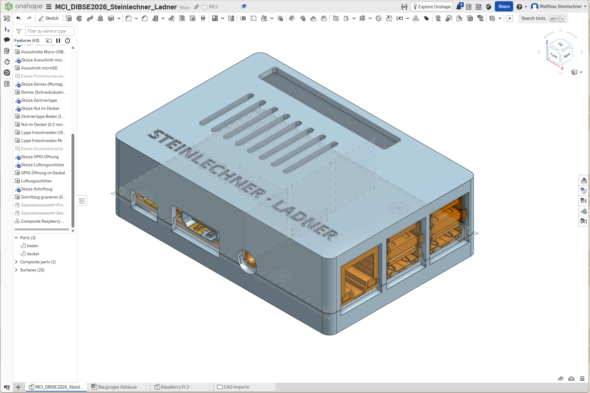

## Inhalt

1. [Zusammenfassung](#1-zusammenfassung)
2. [Aufgabenstellung und Erfüllung](#2-aufgabenstellung-und-erfüllung)
3. [Ausgangslage: eigener Pi und Online-Modell](#3-ausgangslage-eigener-pi-und-online-modell)
4. [Konstruktion in Onshape](#4-konstruktion-in-onshape)
5. [Kollisionsprüfung](#5-kollisionsprüfung)
6. [Export, Slicen und Druckvorbereitung](#6-export-slicen-und-druckvorbereitung)
7. [Dateien in diesem Repository](#7-dateien-in-diesem-repository)
8. [KI-Unterstützung](#8-ki-unterstützung)
9. [Quellen](#9-quellen)

## 1 Zusammenfassung

Wir, Adrian Ladner und Matthias Steinlechner, haben das Gehäuse gemeinsam in einem Online-Call erarbeitet. Das Onshape-Modell lag bei Matthias, gearbeitet wurde an seinem Rechner, Adrian war über den Call und die Bildschirmfreigabe die ganze Zeit dabei.

Grundlage war Matthias' eigener Raspberry Pi 3 (laut Aufdruck Model B+), den wir abgemessen haben, zusammen mit einem öffentlichen Onshape-Modell des Raspberry Pi 3, das wir in unser Dokument übernommen und mitverwendet haben. Von beiden ausgehend haben wir ein zweiteiliges Gehäuse aus Boden und Deckel konstruiert:

- parametrisch aufgebaut (Wandstärke, Spalt, Freiräume und Radius als Variablen)
- Öffnungen für USB, LAN, Micro-USB, HDMI, Audio und microSD
- 4 Schraubdome für M2,5 auf dem Lochbild des Pi
- Zentrierlippe zwischen Boden und Deckel
- Individualisierung: Lüftungsschlitze, GPIO-Öffnung, gravierter Schriftzug „STEINLECHNER · LADNER“

Die Interference Detection in der Baugruppe meldet **keine Überschneidungen**. Gesliced haben wir mit UltiMaker Cura für einen Creality Ender-3 (ca. 5 h 20 min, 38 g PLA, ohne Stützstrukturen). Als Hilfe hat uns der KI-Assistent Claude durch die einzelnen Schritte angeleitet, konstruiert haben wir selbst (siehe [Abschnitt 8](#8-ki-unterstützung)).

| Kennzahl | Wert |
| --- | --- |
| Außenmaße (Rohling) | 90,9 × 62 × 27,75 mm |
| Wandstärke / Spalt zur Platine | 2 mm / 1 mm |
| Teile | 2 (Boden, Deckel) |
| Befestigung | 4 × M2,5 × 6 mm, Deckel über Zentrierlippe |
| Druckzeit / Material | ca. 5 h 20 min / ca. 38 g PLA (12,81 m) |

## 2 Aufgabenstellung und Erfüllung

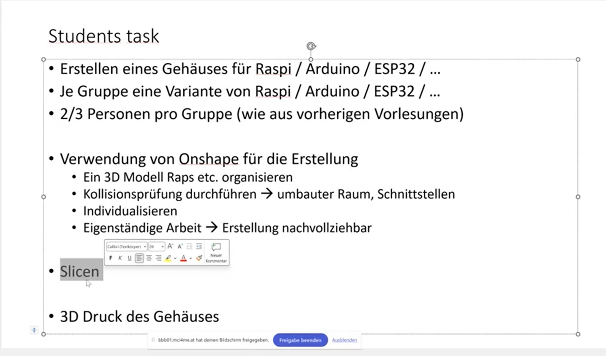

| Anforderung | Umsetzung | Abschnitt |
| --- | --- | --- |
| Gehäuse für Raspi / Arduino / ESP32 | Raspberry Pi 3 | [3](#3-ausgangslage-eigener-pi-und-online-modell) |
| Gruppe mit 2–3 Personen | Matthias Steinlechner, Adrian Ladner | – |
| Onshape verwenden | Dokument `MCI_DIBSE2026_Steinlechner_Ladner` | [4](#4-konstruktion-in-onshape) |
| 3D-Modell des Pi organisieren | Öffentliches Onshape-Modell per STEP importiert, mit eigenem Pi abgeglichen | [3](#3-ausgangslage-eigener-pi-und-online-modell) |
| Kollisionsprüfung (umbauter Raum, Schnittstellen) | Interference Detection: „No interferences“ | [5](#5-kollisionsprüfung) |
| Individualisieren | Schriftzug, Lüftungsschlitze, GPIO-Öffnung | [4](#4-konstruktion-in-onshape) |
| Erstellung nachvollziehbar | Versionen V1–V10 im Onshape-Dokument, Feature-Baum mit sprechenden Namen | [4](#4-konstruktion-in-onshape) |
| Slicen | UltiMaker Cura 5.13, G-Code im Repo | [6](#6-export-slicen-und-druckvorbereitung) |
| 3D-Druck des Gehäuses | Druckdatei für Creality Ender-3 vorbereitet | [6](#6-export-slicen-und-druckvorbereitung) |

## 3 Ausgangslage: eigener Pi und Online-Modell

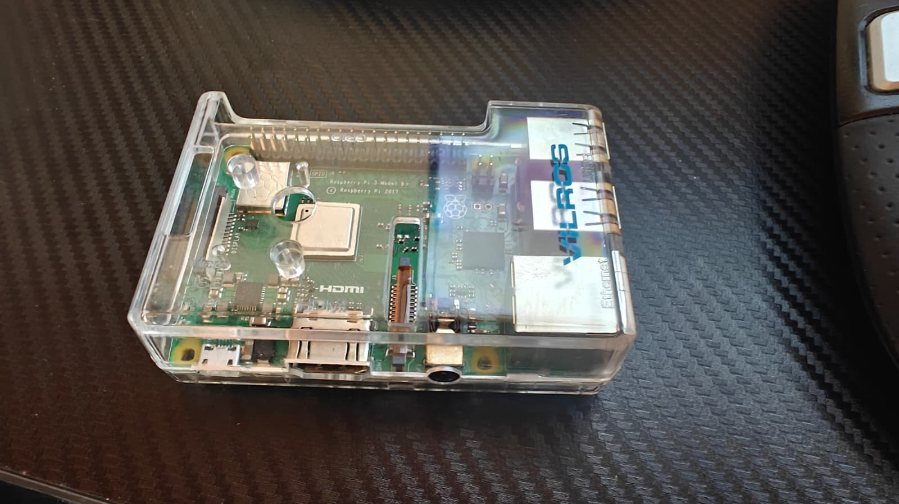

*Matthias' Raspberry Pi 3 (Model B+) im bisherigen Kaufgehäuse – an diesem Pi haben wir gemessen.*

Der Pi 3 hat viele seitliche Anschlüsse (USB, LAN, HDMI, Micro-USB, Audio, microSD) und eignet sich damit gut, um Schnittstellen und umbauten Raum zu üben.

**Abmessen am eigenen Pi:** Platinengröße, Lage der Montagelöcher und die Positionen der Anschlüsse haben wir am realen Pi abgemessen und mit dem Online-Modell verglichen. Für die Konstruktion maßgeblich:

| Maß | Wert |
| --- | --- |
| Platine | 85 × 56 mm |
| Lochbild Montagelöcher | 58 × 49 mm |
| Schrauben | M2,5 |

**Online-Modell übernehmen:** Das 3D-Modell stammt aus einem öffentlichen Onshape-Dokument ([Quelle](#9-quellen)).

1. Im Quelldokument das ganze Part Studio „Raspberry Pi 3“ als **STEP (AP242)** exportiert, nicht nur ein einzelnes Teil.
2. In unserem Dokument über **+ → Import** mit der Option **„Combine to a single Part Studio“** importiert (427 Teile).
3. Im Gehäuse-Part-Studio mit **Derived** eingefügt. Die Platine liegt flach auf der Top-Ebene, Ausrichten war nicht nötig.
4. Platinenmaße und Lochbild im Modell nachgemessen und mit unseren Messungen am echten Pi abgeglichen.

## 4 Konstruktion in Onshape

Das Gehäuse ist parametrisch aufgebaut: Wandstärke, Spalt, Freiräume und Radius stecken in Variablen, sodass sich alle abhängigen Maße mitändern. Nach jedem Schritt haben wir in Onshape eine Version gespeichert, sodass jeder Zwischenstand im Dokument nachvollziehbar ist.

| Version | Schritt | Was und warum |
| --- | --- | --- |
| V1 | Variablen + Rohling | Variablen `wand` 2 mm, `spalt` 1 mm, `freiraum_unten` 4 mm, `freiraum_oben` 2,5 mm, `radius` 3 mm. Rechteck-Skizze um die Platine, extrudiert zu einem Block 90,9 × 62 × 27,75 mm, Außenecken verrundet. |
| V2 | Boden + Deckel | Trennebene auf der Platinenoberseite, Block mit **Split** in *boden* und *deckel* geteilt, beide mit **Shell** auf 2 mm Wand ausgehöhlt. |
| V3 | Anschlussöffnungen | Ausschnitte für USB, LAN, Micro-USB, HDMI, Audio und microSD mit 0,5 mm Spiel. Merge Scope nur auf Boden/Deckel, damit das Pi-Modell nicht mitgeschnitten wird. |
| V4 | Schraubdome | 4 Dome Ø 6 mm auf dem Lochbild 58 × 49 mm, Kernloch Ø 2,2 mm für M2,5-Schrauben, Höhe = `freiraum_unten`. |
| V5 | Zentrierlippe | Lippe 1 × 2 mm am Boden, passende Nut mit 0,2 mm Spiel im Deckel, Lippe an den Anschlüssen wieder freigeschnitten. |
| V6 | Individualisierung | 8 Lüftungsschlitze über dem Prozessor, Öffnung für die GPIO-Leiste, Schriftzug „STEINLECHNER · LADNER“ 0,6 mm graviert. |
| V7 | Explosionsansicht | Pi und Deckel mit Transform angehoben, nur zur Darstellung; für Export und Prüfung unterdrückt. |

### Explosionsansicht

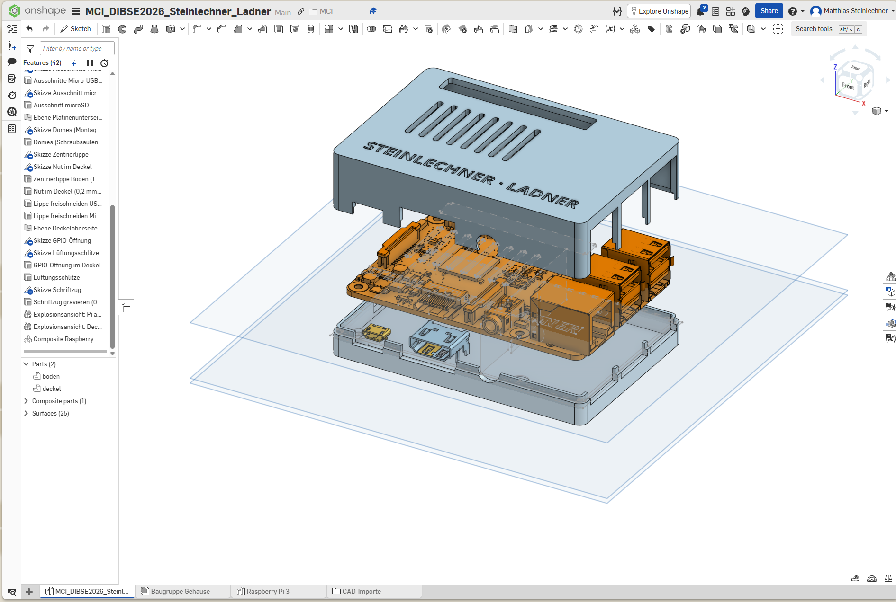

### Ansichten

| Vorne | Hinten |
| --- | --- |
| 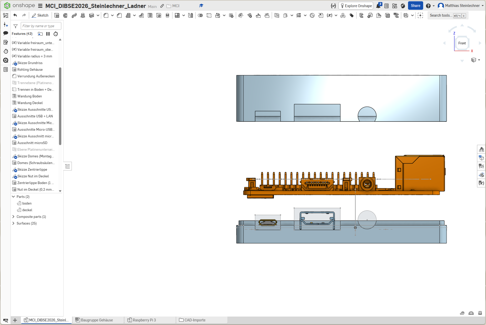 | 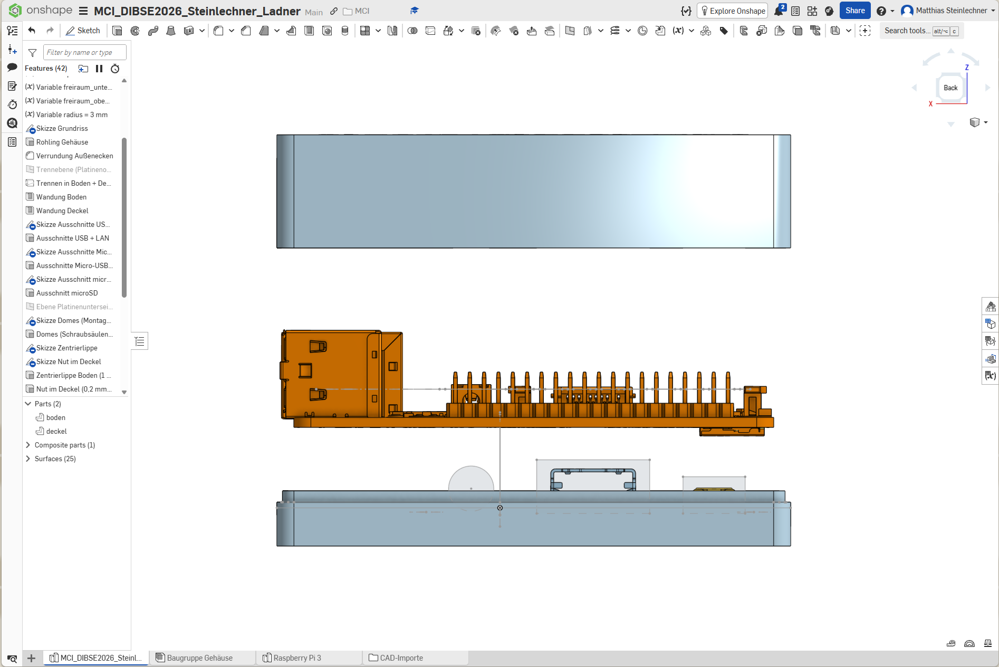 |
| **Links** | **Rechts** |
| 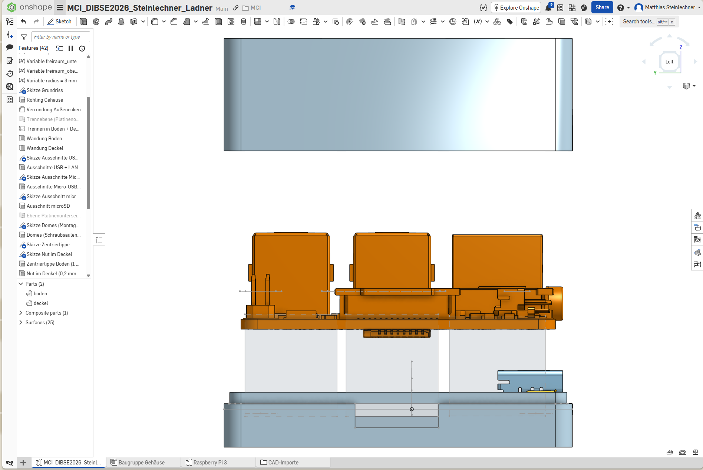 | 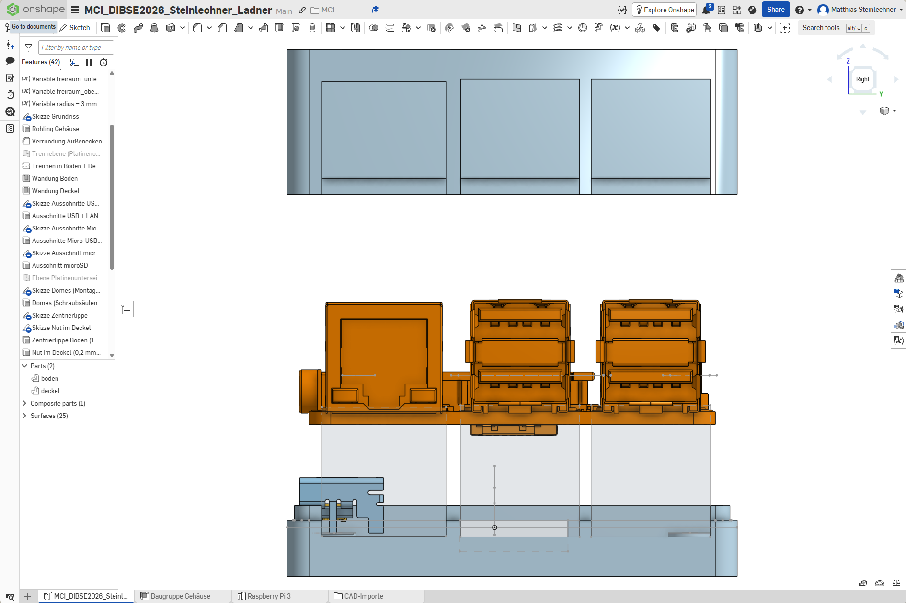 |
| **Oben** | **Unten** |
| 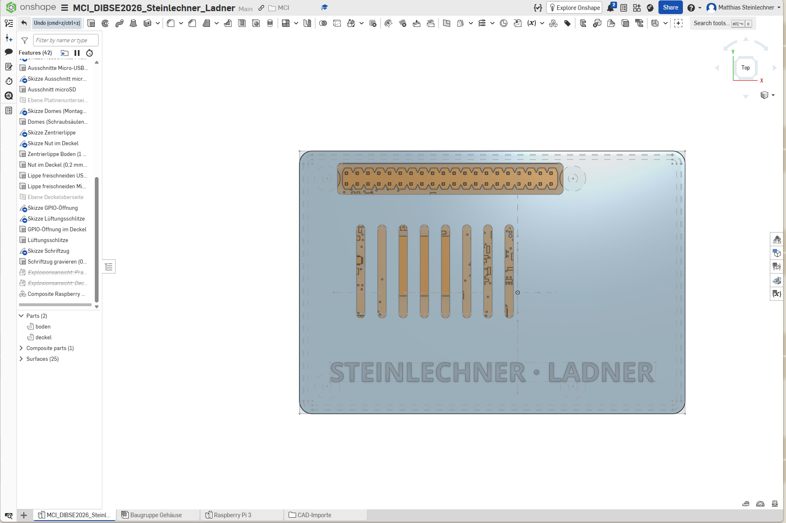 | 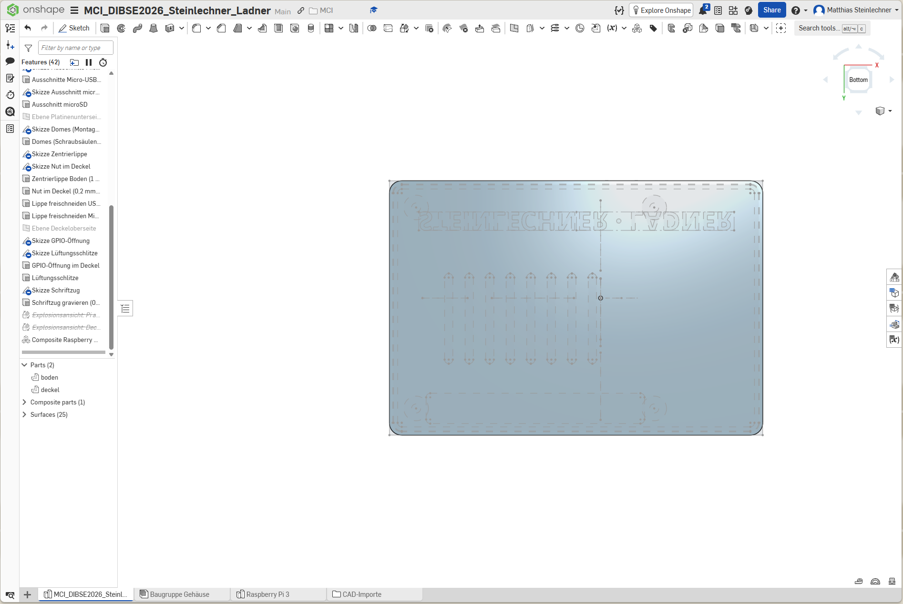 |

## 5 Kollisionsprüfung

Die Interference Detection in der Baugruppe meldet **keine Überschneidungen** zwischen Pi, Boden und Deckel (Versionen V8–V10).

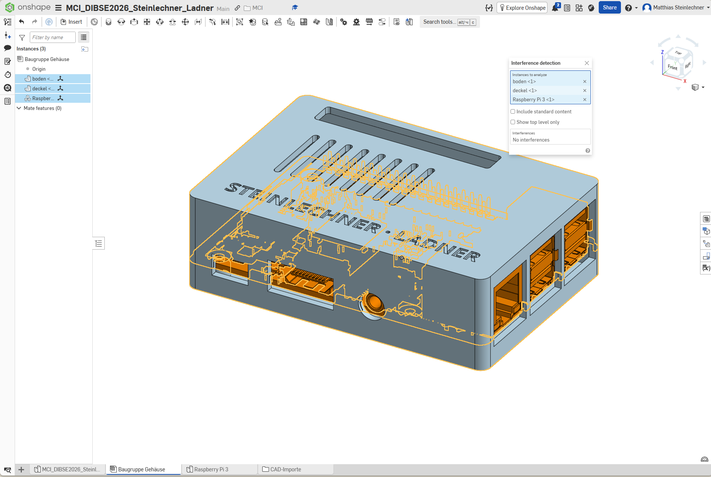

1. Baugruppe „Baugruppe Gehäuse“ angelegt.
2. Erster Versuch mit allen 427 Pi-Teilen: zu viele Treffer innerhalb des Pi-Modells selbst, Onshape brach mit einer Warnung ab.
3. Lösung: die Pi-Teile im Part Studio mit **Composite part (Closed)** zu einem Teil „Raspberry Pi 3“ zusammengefasst und die Baugruppe mit 3 Instanzen neu aufgebaut.
4. Interference Detection mit *boden*, *deckel* und *Raspberry Pi 3*: Ergebnis „No interferences“. Zwischen Boden und Deckel gibt es nur Berührung, keine Überschneidung.

Damit ist geprüft, dass die Platine samt aller Bauteile im umbauten Raum Platz hat und an den Anschlussöffnungen nirgends am Gehäuse ansteht.

## 6 Export, Slicen und Druckvorbereitung

Gesliced haben wir mit **UltiMaker Cura 5.13** für einen **Creality Ender-3**. Da die Aufgabe keinen Drucker vorgibt, lässt sich das Druckerprofil bei Bedarf austauschen.

1. Boden und Deckel einzeln als **STL** exportiert (Binary, Millimeter, Fine).
2. Cura gewählt, weil es kostenlos ist, an Hochschulen verbreitet ist und Profile für fast alle Drucker mitbringt.
3. Boden flach mit der offenen Seite nach oben, Deckel kopfüber mit dem Schriftzug auf dem Bett. So braucht keines der beiden Teile Stützstrukturen.
4. Einstellungen und G-Code gespeichert.

| STL-Export in Onshape | Druckerprofil in Cura |
| --- | --- |
| 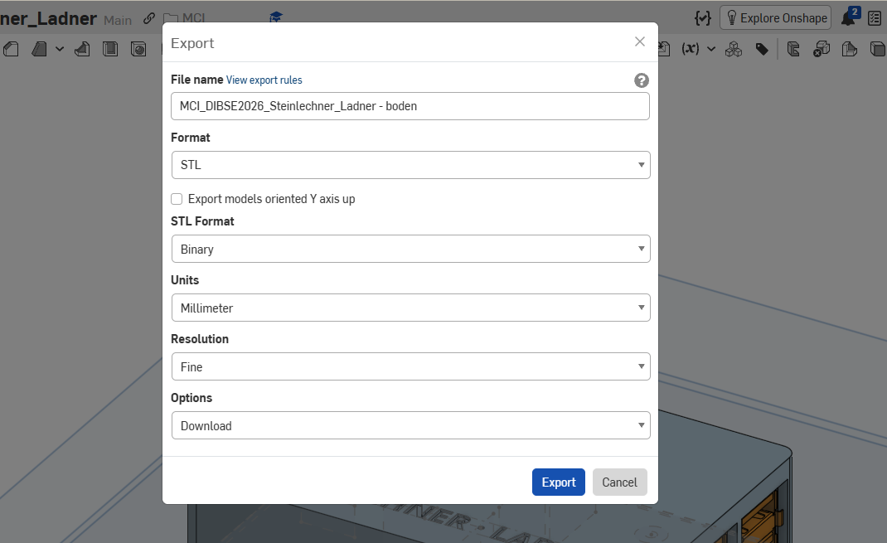 | 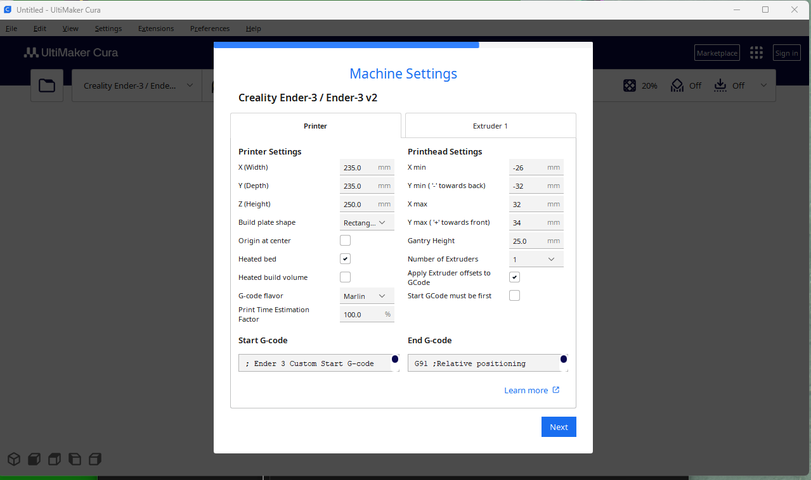 |

| Einstellung | Wert |
| --- | --- |
| Drucker | Creality Ender-3 / Ender-3 v2, Düse 0,4 mm |
| Material | Generic PLA, Düse 200 °C, Bett 50 °C |
| Schichthöhe | 0,2 mm (Standard Quality) |
| Wandlinien | 3 |
| Infill | 20 % |
| Support | aus |
| Haftung | Skirt |
| Ergebnis | ca. 5 h 20 min, ca. 38 g PLA (12,81 m) |

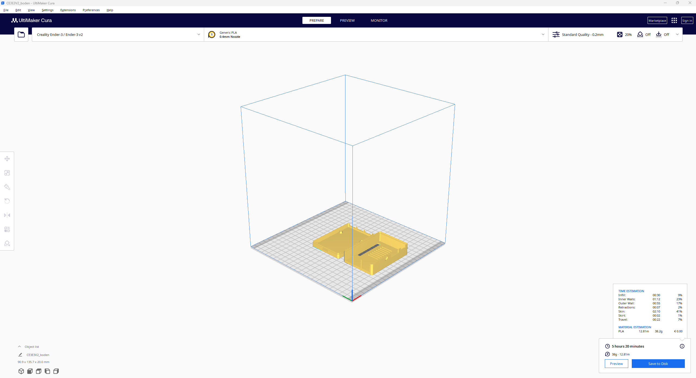

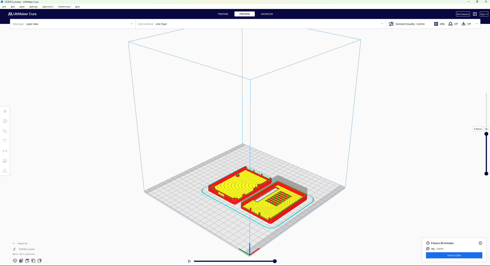

**Montage:** Pi auf die vier Dome setzen, mit 4 Schrauben M2,5 × 6 mm befestigen, Deckel aufsetzen. Er hält durch die Zentrierlippe.

## 7 Dateien in diesem Repository

| Pfad | Inhalt |
| --- | --- |
| `README.md` | dieses Abgabedokument |
| `Abgabe_Steinlechner_Ladner.pdf` | dasselbe Dokument als PDF |
| `cad/boden.stl` | Gehäuseboden, STL für den 3D-Druck |
| `cad/deckel.stl` | Gehäusedeckel, STL für den 3D-Druck |
| `cad/raspberry_pi_3.step` | verwendetes Pi-3-Modell (STEP-Export aus dem öffentlichen Onshape-Dokument) |
| `slicer/MCI_DIBSE2026_Steinlechner_Ladner.gcode` | G-Code für Creality Ender-3 (Boden und Deckel in einem Druck) |
| `bilder/` | Screenshots aus Onshape und Cura, Foto des Pi, Aufgabenstellung |

Das vollständige, parametrische Modell mit Feature-Baum und Versionshistorie liegt im [Onshape-Dokument](https://cad.onshape.com/documents/86bf8634dd22ef38d0c91736/w/d0a2e91c8ee4754ec98ff0cc/e/dff0a90386fe0cac06c8877a).

## 8 KI-Unterstützung

Wie in der Lehrveranstaltung erlaubt, haben wir den KI-Assistenten Claude (Anthropic) als Hilfe eingesetzt. Claude hat uns die Schritte angewiesen, also das Vorgehen erklärt und gezeigt, welche Onshape-Features sich für welchen Schritt eignen.

Konstruiert, geprüft und gesliced haben wir selbst, gemeinsam im Online-Call an Matthias' Rechner. Dieses Abgabedokument haben wir mit Unterstützung von Claude aus unseren Notizen und Screenshots zusammengestellt.

## 9 Quellen

- Raspberry-Pi-3-Modell (öffentliches Onshape-Dokument): <https://cad.onshape.com/documents/f7ccf47ceb16e1d3810500c3/w/5d7b49ad857bb43781acadd4/e/da6d5f7b2658c3010fcb7332>
- Referenzgehäuse zur Orientierung (öffentliches Onshape-Dokument): <https://cad.onshape.com/documents/bcc52cb1b28d8c9cb22a945f/w/bce421404abcce7eb8def9c4/e/a31f16b2811e440960ca9946>
- Onshape: <https://www.onshape.com>
- UltiMaker Cura 5.13: <https://ultimaker.com/software/ultimaker-cura/>
